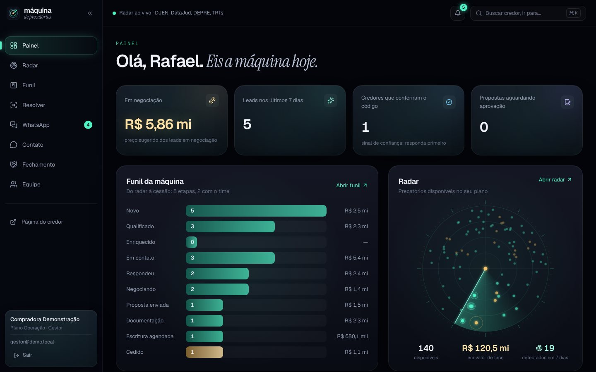
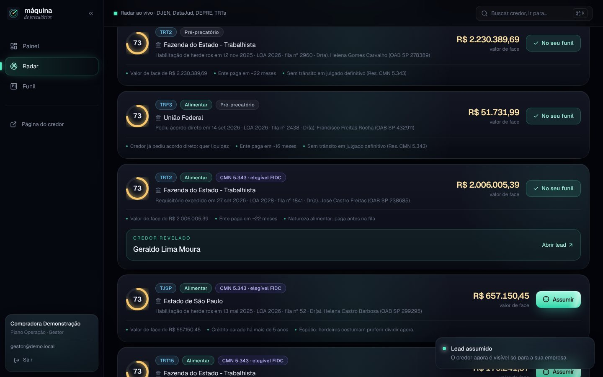
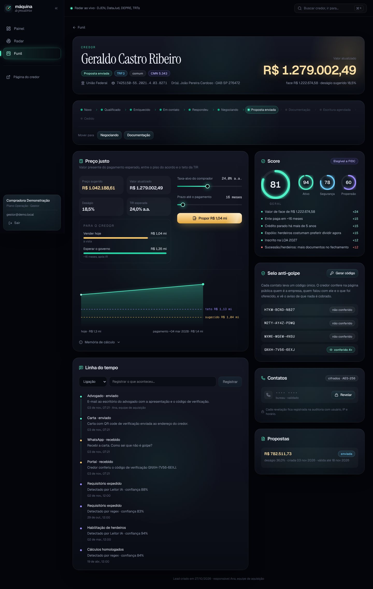
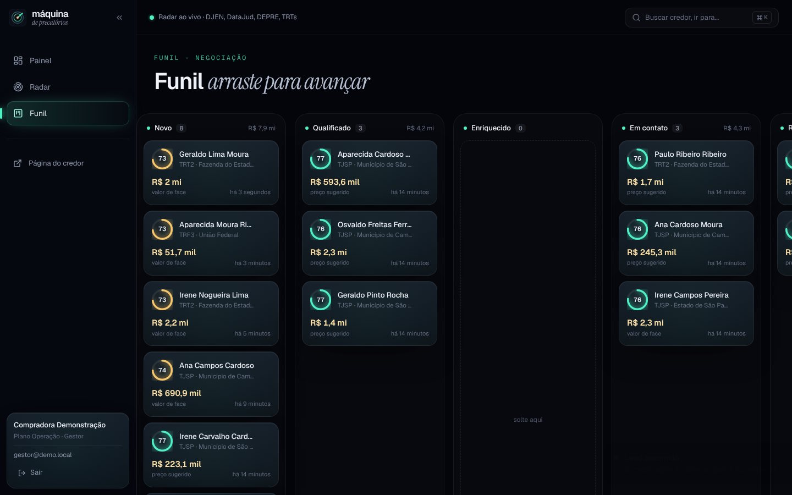
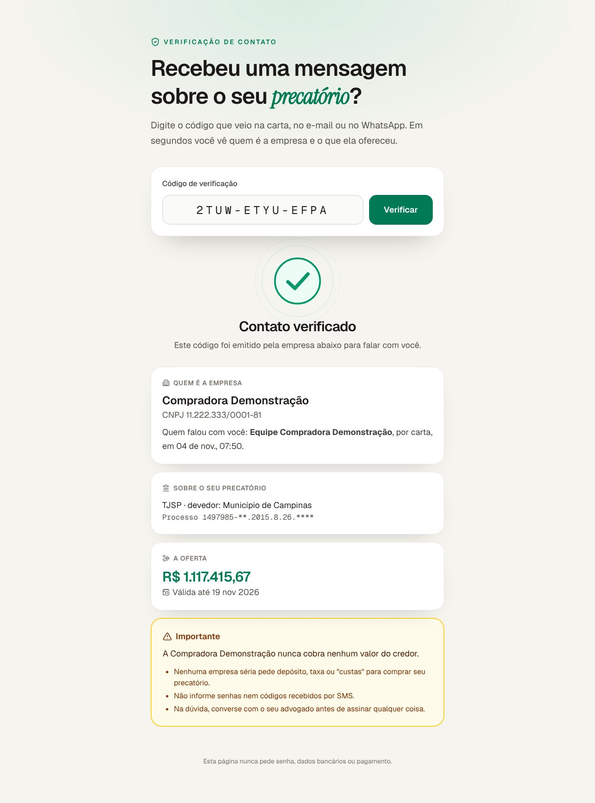

# Máquina de Prospecção de Precatórios

Do Diário da Justiça à escritura assinada: radar de precatórios, score, preço justo explicável, contato com selo anti-golpe e funil até a cessão. É multi-tenant desde o primeiro dia.

| Login | Painel | Radar (credor revelado) |
|---|---|---|
|  |  |  |
| **Lead e preço justo** | **Funil** | **Página pública do credor** |
|  |  |  |

## Arquitetura

```
navegador ── HTTPS ──> nginx (web) ─┬─ /            SPA pública (login, verificação)
                                    ├─ /app-assets/ código interno, só com sessão (auth_request)
                                    └─ /api/        FastAPI ── maquina_api ──> Postgres (Supabase)
                                                       │        └ por requisição: role authenticated
                                                       │          + claims do JWT verificado (RLS)
                                                       ├─ Redis: limites, orçamento anti-raspagem
                                                       └─ Supabase Auth: senha, refresh, (MFA)
worker ── maquina_worker ──> core.*   coleta DJEN (D+1) -> triagem regex -> Leitor IA (Claude)
   │        └ fila no próprio Postgres (SKIP LOCKED + aluguel), orçamento diário em US$
   └─ HTTPS só para comunicaapi.pje.jus.br e api.anthropic.com
```

- **`supabase/migrations/`**: schema, RLS por papel e funções auditadas. Veja [`docs/DECISOES-BANCO.md`](docs/DECISOES-BANCO.md) para o que mudou em relação ao schema original e por quê.
- **`backend/`**: FastAPI, organizado em `app/dominio` (regras puras de score, preço e funil), `app/consultas` (SQL parametrizado), `app/rotas`, `app/seguranca` e `app/auth`. O worker fica em `backend/worker` (mesma imagem Docker, outro comando).
- **`frontend/`**: React 19, Tailwind 4 e Motion. `src/publico` é aberto; `src/app` é a área logada, protegida no build e no nginx.
- **[`SECURITY.md`](SECURITY.md)**: ameaças, controles e o teste que prova cada um.
- **[`docs/DEPLOY.md`](docs/DEPLOY.md)**: Supabase e Easypanel passo a passo.

## Estado dos módulos (escopo do MVP)

| Módulo | Situação |
|--------|----------|
| 1. Radar | Pronto: tela, API, filtros, orçamento diário e escopo por plano. Coletor do DJEN pronto (D+1, paginado, idempotente, educado com a fonte e parando no primeiro sinal de bloqueio). DataJud, DEPRE e TRTs ainda não começaram. |
| 2. Leitor IA | Pronto: triagem por regex (sem custo) e extração com Claude em formato estruturado, revalidada antes de gravar (CNJ, CPF/CNPJ com dígito, valores, datas, OAB). Orçamento diário, fallback em recusa e custo de cada chamada registrado. Vem desligado: ligue depois de rodar a `sonda` (veja o deploy). |
| 3. Resolver | Pronto: revelação de credor e herdeiros com cota; busca de telefone, e-mail e endereço no bureau (BigDataCorp pela API, manual ou automática para lead qualificado, com teto diário e sonda) e planilha de qualquer bureau (exporta CPFs auditado, importa o resultado com reconhecimento de colunas). CPF informado pela equipe quando o processo não traz. |
| 4. Score e preço | Pronto: score com motivos, preço justo (piso do acordo estatal, teto pela TIR, cenários e memória de cálculo) e elegibilidade CMN 5.343. |
| 5. Contato | Pronto: selo anti-golpe (código, página pública, sinal de "credor conferiu"), contatos cifrados (telefone, e-mail, endereço), WhatsApp oficial da Meta (modelos com autorização registrada, texto livre só na janela de 24 h, "PARAR" respeitado na hora, webhook assinado), cadências automáticas (WhatsApp, ligação, carta, e-mail, advogado) que viram tarefas quando precisam de alguém, e carta com QR code em PDF. |
| 6. Negociação | Prontos o simulador (recalculado no servidor), as propostas com alçada e o PDF da proposta para o credor (comparação vender hoje x esperar x acordo, código anti-golpe com QR code, marca d'água em rascunho). |
| 7. Fechamento | O funil até "cedido" está pronto. A sala de cessão (documentos e e-Notariado) ainda não começou. |

## Rodando localmente

Pré-requisitos: Python 3.13 com [uv](https://docs.astral.sh/uv/), Node 22, Postgres 16 e `redis-server`.

```bash
scripts/dev-ambiente.sh
```

O script cria o banco, aplica as migrações, gera `.dev/dev.env` com chaves locais e popula com dados fictícios. Depois, em quatro terminais (todos com `source .dev/dev.env`):

```bash
redis-server --port 6390 --save '' --appendonly no
```

```bash
cd backend && uv run uvicorn dev.auth_local:app --host 127.0.0.1 --port 9999
```

```bash
make dev-api
```

```bash
make dev-front
```

Abra http://localhost:5173 e entre com `gestor@demo.local` / `demo-precatorios-2026` (há também `dona@`, `operadora@` e `leitura@` para testar os papéis).

> `dev/auth_local.py` imita o Supabase Auth só para desenvolvimento: escuta em 127.0.0.1, recusa rodar em produção e não entra na imagem Docker.

O worker é opcional no dia a dia: `make dev-worker` coleta o DJEN de verdade para o banco local (Leitor IA desligado, a não ser que você defina `MAQUINA_LEITOR_ATIVO=true` e `ANTHROPIC_API_KEY`). Comandos avulsos:

```bash
cd backend && uv run python -m worker sonda TJSP            # o DJEN responde daqui? quais campos vêm?
cd backend && uv run python -m worker coletar TJSP 2026-11-02
cd backend && uv run python -m worker triar
cd backend && uv run python -m worker extrair --limite 20
```

## Testes

```bash
make testes
```

| Suíte | O que cobre |
|-------|-------------|
| `backend/tests/banco` (115) | RLS e isolamento por tenant e papel, cotas, mascaramento do credor, código anti-golpe, auditoria imutável, gestão da equipe, integração do WhatsApp (segredos sem grant, fila do webhook só para o worker), Resolver (CPF que a tela não lê, planilha só com os próprios leads) e guardas de regressão (toda tabela com RLS, lista fechada de funções expostas). |
| `backend/tests/api` (75) | Cabeçalhos, CSRF, limite de corpo, login e cookies, JWT forjado, força bruta, renovação com reuso derrubando a sessão, radar, cotas, contatos cifrados, propostas e alçada, PDFs com auditoria, convites e senha, WhatsApp (segredos cifrados, webhook, autorização e janela), cadências, carta e tarefas, bureau e planilha (exportação auditada sem fórmula, importação só com os próprios leads), página pública, conexões derrubadas. |
| `backend/tests/unidade` (80) | Preço justo conferido à mão, score, funil, CNJ, endereço, PDFs (proposta e carta, texto externo escapado), cifra (AAD, rotação, adulteração), redação de logs, limitador, configuração insegura recusada e as travas das ferramentas de desenvolvimento. |
| `backend/tests/worker` (187) | Triagem; cliente do DJEN (paginação, Retry-After, backoff, bloqueio, redirecionamento recusado); Leitor IA pelo SDK oficial com transporte simulado (formato do pedido, recusa, saída cortada, erros, custo com fallback); fila no Postgres como `maquina_worker` (dois workers sem duplicar, aluguel vencido, backoff, orçamento, chave errada); gravação (CPF/CNPJ só cifrado, status que não regride, lixo do modelo descartado, nada de nome no radar); mensageiro do WhatsApp (assinatura da Meta, resposta do credor movendo o funil, nono dígito, PARAR, status que só avança, janela de 24 h, token recusado, erros temporários e definitivos) e cadências; bureau (pedido, leitura tolerante, sonda sem dado pessoal) e Resolvedor (teto diário, credencial recusada, modo automático, oposição preservada); e um ciclo de ponta a ponta até o radar e o lead na API. |
| `frontend/src/**/*.test.ts` (33) | Cliente HTTP (CSRF, renovação única e compartilhada, download por POST, mapeamento de erros), formatação, preferências, senha regras de contato (cadência, janela de 24 h) e leitor de planilha (CSV com aspas, colunas reconhecidas, lotes). |
| `frontend/scripts/telas.cjs` | Navegador real, de ponta a ponta: login, painel, radar, assumir lead, funil, preço justo, revelar contato, gerar código, paleta e página pública. Falha com qualquer erro de console ou 5xx; contra o nginx, também com violação de CSP. |

O CI (`.github/workflows/ci.yml`) roda tudo isso, além de `ruff`, `mypy --strict`, `npm audit` e `pip-audit`.

## Licença

Software proprietário. Todos os direitos reservados. Veja [`LICENSE`](LICENSE).
